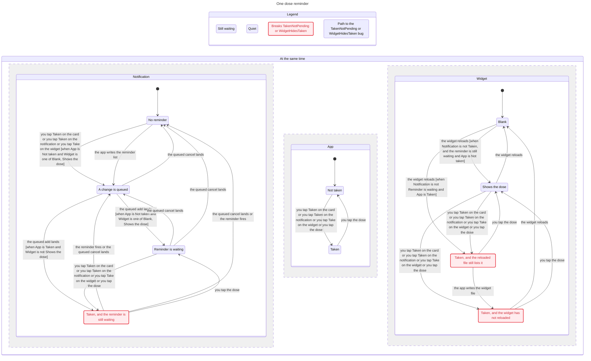

# Dose reminder

`WidgetHidesTaken` breaks. A taken dose is not on the widget. The shortest path has 3 steps: the app writes the widget file, you tap Taken on the card, and the widget reloads onto a file that still lists the dose.

`TakenNotPending` breaks. A taken dose leaves no reminder that can still fire. The shortest path has 4 steps: the app reads the pending reminders, the app writes the reminder list, the queued add lands, and you tap Taken on the card while that reminder is still waiting.

`WritersAgree` holds. TLC found none. The dose log stays pending or taken.

The chart hides a take that starts from a dose already taken, a fire while the dose is not taken, and a step that stays on the same labels. It keeps the label on the pending-reminder read and on the widget-file write, because those steps sit on a bug path even when the labels do not change.

The model uses one `live` bit, so it cannot show a follow-up or a snooze beside the dose id, and it cannot show snooze leaving the dose id in place. It leaves out the master switch, a denied authorization, a second `reschedule`, a second dose log, tomorrow's frozen `nextMeds`, and the follow-up schedule in `ReminderLogic.followUpPlan`. The queue keeps the last two ops.

Regenerate with `/statechart` on `ios/formal/dose-reminder/DoseReminder.tla`, using `ios/formal/dose-reminder/DoseReminder.cfg` and `ios/formal/dose-reminder/view.mjs`, into an empty directory. `ios/scripts/check-statecharts.py` checks the fence.
