# Dose reminder

This picture is one dose at one time, and a second saved log is purple. Red arrows are the shortest way each broken rule fails. Pink is the shortest way to a taken dose with no reminder and a blank widget. Where that way shares an arrow with a broken rule, the arrow stays red.

## What TLC checked

TakenNotPending failed in 3 steps. A taken dose can still have a reminder waiting.

WritersAgree failed in 3 steps. One time can have two logs. Those two logs can disagree after 5 steps.

WidgetHidesTaken failed in 3 steps. A taken dose can still show on the widget.

NoDeadlock holds.

TLC found 338 distinct states when the checks are off. A separate reminder read reached 1016 distinct states, and a read that only remembers that it looked still reached 676. Both are past the 500-state picture budget, so that read and the reminder write are one step.

The model leaves out a skipped dose, a second time slot, snooze, and a follow-up reminder.

The chart hides Done, a fire while the dose is not taken, and a second take that starts already taken.

`python3 ios/scripts/check-statecharts.py` checks this fence and this picture.

```mermaid
---
title: "One dose reminder"
---
stateDiagram-v2
  state "Legend" as legend {
    lg0: Two logs
    lg1: Still waiting
    lg2: Stale widget
    lg3: Quiet
    lg4: Breaks TakenNotPending or WidgetHidesTaken or WritersAgree
    lg5: Path to the TakenNotPending or WidgetHidesTaken or WritersAgree bug
  }
  class lg0 purple
  class lg1 pink
  class lg2 orange
  class lg3 teal
  class lg4 breaks
  class lg5 bugPath
  state "Notification No reminder" as s0 {
    state "App Not taken" as s1 {
      s2: Widget Blank
      s3: Widget Shows the dose
    }
    state "App Taken" as s4 {
      s5: Widget Blank
      s6: Widget Taken, and the widget has not reloaded
      s7: Widget Taken, and the reloaded file still lists it
    }
    state "App Taken, and a second log is there" as s8 {
      s9: Widget Blank
      s10: Widget Taken, and the widget has not reloaded
      s11: Widget Taken, and the reloaded file still lists it
    }
    state "App Not taken, and a second log is there" as s12 {
      s13: Widget Blank
      s14: Widget Shows the dose
    }
  }
  state "Notification A change is queued" as s15 {
    state "App Not taken" as s16 {
      s17: Widget Blank
      s18: Widget Shows the dose
    }
    state "App Taken" as s19 {
      s20: Widget Blank
      s21: Widget Taken, and the widget has not reloaded
      s22: Widget Taken, and the reloaded file still lists it
    }
    state "App Taken, and a second log is there" as s23 {
      s24: Widget Blank
      s25: Widget Taken, and the widget has not reloaded
      s26: Widget Taken, and the reloaded file still lists it
    }
    state "App Not taken, and a second log is there" as s27 {
      s28: Widget Blank
      s29: Widget Shows the dose
    }
  }
  state "Notification Reminder is waiting" as s30 {
    state "App Not taken" as s31 {
      s32: Widget Blank
      s33: Widget Shows the dose
    }
    state "App Not taken, and a second log is there" as s34 {
      s35: Widget Blank
      s36: Widget Shows the dose
    }
  }
  state "Notification Taken, and the reminder is still waiting" as s37 {
    state "App Taken" as s38 {
      s39: Widget Blank
      s40: Widget Taken, and the widget has not reloaded
      s41: Widget Taken, and the reloaded file still lists it
    }
    state "App Taken, and a second log is there" as s42 {
      s43: Widget Blank
      s44: Widget Taken, and the widget has not reloaded
      s45: Widget Taken, and the reloaded file still lists it
    }
  }
  [*] --> s2
  s2 --> s17: the app writes the reminder list
  s2 --> s20: you tap Taken on the card or you tap Taken on the notification or you tap Take on the widget
  s2 --> s2: the dose button keeps the log it showed or the app writes the widget file
  s17 --> s20: you tap Taken on the card or you tap Taken on the notification or you tap Take on the widget or you tap the dose
  s17 --> s32: the queued add lands
  s20 --> s5: the queued cancel lands
  s2 --> s5: you tap the dose
  s2 --> s3: the widget reloads
  s20 --> s39: the queued add lands
  s20 --> s17: you tap the dose
  s20 --> s24: you tap the dose
  s32 --> s39: you tap Taken on the card or you tap Taken on the notification or you tap Take on the widget or you tap the dose
  s17 --> s18: the widget reloads
  s20 --> s22: the widget reloads
  s3 --> s21: you tap Taken on the card or you tap Taken on the notification or you tap Take on the widget
  s3 --> s18: the app writes the reminder list
  s3 --> s22: you tap Taken on the card or you tap Taken on the notification or you tap Take on the widget
  s32 --> s17: the queued cancel lands
  s17 --> s2: the queued cancel lands
  s24 --> s9: the queued cancel lands
  s39 --> s20: the reminder fires or the queued cancel lands
  s39 --> s5: the queued cancel lands or the reminder fires
  s21 --> s20: the widget reloads
  s21 --> s6: the queued cancel lands
  s5 --> s2: you tap the dose
  s5 --> s9: you tap the dose
  s18 --> s21: you tap Taken on the card or you tap Taken on the notification or you tap Take on the widget or you tap the dose
  s18 --> s22: you tap Taken on the card or you tap Taken on the notification or you tap Take on the widget or you tap the dose
  s18 --> s33: the queued add lands
  s22 --> s21: the app writes the widget file
  s22 --> s7: the queued cancel lands
  s32 --> s33: the widget reloads
  s5 --> s7: the widget reloads
  s3 --> s6: you tap the dose
  s3 --> s7: you tap the dose
  s24 --> s43: the queued add lands
  s21 --> s40: the queued add lands
  s24 --> s28: you tap the dose
  s39 --> s32: you tap the dose
  s39 --> s43: you tap the dose
  s21 --> s18: you tap the dose
  s21 --> s25: you tap the dose
  s6 --> s5: the widget reloads
  s22 --> s41: the queued add lands
  s24 --> s26: the widget reloads
  s39 --> s41: the widget reloads
  s18 --> s3: the queued cancel lands
  s22 --> s18: you tap the dose
  s22 --> s25: you tap the dose
  s22 --> s26: you tap the dose
  s33 --> s40: you tap Taken on the card or you tap Taken on the notification or you tap Take on the widget or you tap the dose
  s33 --> s41: you tap Taken on the card or you tap Taken on the notification or you tap Take on the widget or you tap the dose
  s7 --> s6: the app writes the widget file
  s32 --> s2: the queued cancel lands
  s28 --> s24: you tap Taken on the card or you tap Taken on the notification or you tap Take on the widget or you tap the dose
  s28 --> s13: the queued cancel lands
  s43 --> s24: the reminder fires or the queued cancel lands
  s43 --> s9: the queued cancel lands or the reminder fires
  s18 --> s17: the widget reloads
  s25 --> s24: the widget reloads
  s25 --> s10: the queued cancel lands
  s40 --> s39: the widget reloads
  s40 --> s21: the reminder fires or the queued cancel lands
  s40 --> s6: the queued cancel lands or the reminder fires
  s9 --> s13: you tap the dose
  s6 --> s3: you tap the dose
  s6 --> s10: you tap the dose
  s33 --> s18: the queued cancel lands
  s28 --> s29: the widget reloads
  s26 --> s25: the app writes the widget file
  s26 --> s11: the queued cancel lands
  s41 --> s22: the reminder fires or the queued cancel lands
  s41 --> s7: the queued cancel lands or the reminder fires
  s41 --> s40: the app writes the widget file
  s9 --> s11: the widget reloads
  s7 --> s3: you tap the dose
  s7 --> s10: you tap the dose
  s7 --> s11: you tap the dose
  s28 --> s35: the queued add lands
  s25 --> s44: the queued add lands
  s43 --> s35: you tap the dose
  s25 --> s29: you tap the dose
  s40 --> s33: you tap the dose
  s40 --> s44: you tap the dose
  s13 --> s24: you tap Taken on the card or you tap Taken on the notification or you tap Take on the widget
  s13 --> s28: the app writes the reminder list
  s3 --> s2: the widget reloads
  s10 --> s9: the widget reloads
  s26 --> s45: the queued add lands
  s43 --> s45: the widget reloads
  s33 --> s3: the queued cancel lands
  s29 --> s25: you tap Taken on the card or you tap Taken on the notification or you tap Take on the widget or you tap the dose
  s29 --> s26: you tap Taken on the card or you tap Taken on the notification or you tap Take on the widget or you tap the dose
  s29 --> s14: the queued cancel lands
  s26 --> s29: you tap the dose
  s41 --> s33: you tap the dose
  s41 --> s44: you tap the dose
  s41 --> s45: you tap the dose
  s13 --> s14: the widget reloads
  s11 --> s10: the app writes the widget file
  s35 --> s43: you tap Taken on the card or you tap Taken on the notification or you tap Take on the widget or you tap the dose
  s35 --> s13: the queued cancel lands
  s33 --> s32: the widget reloads
  s29 --> s28: the widget reloads
  s44 --> s43: the widget reloads
  s44 --> s25: the reminder fires or the queued cancel lands
  s44 --> s10: the queued cancel lands or the reminder fires
  s13 --> s9: you tap the dose
  s10 --> s14: you tap the dose
  s29 --> s36: the queued add lands
  s35 --> s36: the widget reloads
  s45 --> s26: the reminder fires or the queued cancel lands
  s45 --> s11: the queued cancel lands or the reminder fires
  s45 --> s44: the app writes the widget file
  s14 --> s25: you tap Taken on the card or you tap Taken on the notification or you tap Take on the widget
  s14 --> s26: you tap Taken on the card or you tap Taken on the notification or you tap Take on the widget
  s14 --> s29: the app writes the reminder list
  s11 --> s14: you tap the dose
  s35 --> s28: the queued cancel lands
  s44 --> s36: you tap the dose
  s14 --> s13: the widget reloads
  s36 --> s44: you tap Taken on the card or you tap Taken on the notification or you tap Take on the widget or you tap the dose
  s36 --> s45: you tap Taken on the card or you tap Taken on the notification or you tap Take on the widget or you tap the dose
  s36 --> s14: the queued cancel lands
  s45 --> s36: you tap the dose
  s14 --> s10: you tap the dose
  s14 --> s11: you tap the dose
  s36 --> s35: the widget reloads
  s36 --> s29: the queued cancel lands
  classDef breaks fill:#ffecee,stroke:#e72e3b,stroke-width:2.5px,color:#cd2834
  class s2 teal
  class s2 bugPath
  class s3 teal
  class s5 teal
  class s6 orange
  class s6 breaks
  class s7 orange
  class s7 breaks
  class s9 purple
  class s9 breaks
  class s10 purple
  class s10 breaks
  class s11 purple
  class s11 breaks
  class s13 purple
  class s13 breaks
  class s14 purple
  class s14 breaks
  class s17 teal
  class s17 bugPath
  class s18 teal
  class s20 teal
  class s20 bugPath
  class s21 orange
  class s21 breaks
  class s22 orange
  class s22 breaks
  class s22 bugPath
  class s24 purple
  class s24 breaks
  class s24 bugPath
  class s25 purple
  class s25 breaks
  class s26 purple
  class s26 breaks
  class s28 purple
  class s28 breaks
  class s29 purple
  class s29 breaks
  class s32 teal
  class s32 bugPath
  class s33 teal
  class s35 purple
  class s35 breaks
  class s36 purple
  class s36 breaks
  class s39 pink
  class s39 breaks
  class s39 bugPath
  class s40 pink
  class s40 breaks
  class s41 pink
  class s41 breaks
  class s43 purple
  class s43 breaks
  class s44 purple
  class s44 breaks
  class s45 purple
  class s45 breaks
  classDef happy fill:#ffcbe6,stroke:#c45c8a
  classDef bugPath stroke:#e72e3b,stroke-width:2.5px
  class s2 happy
  class s20 happy
  class s5 happy
```

