# Dose reminder

This picture is the shortest quiet taken dose and the shortest way each broken rule fails. The thick pink line is that quiet dose. The thick red lines are the broken rules. A line that is both stays red. The full picture is linked under this one.

[The full picture](dose-reminder-full.svg)

## What TLC checked

TakenNotPending holds. A taken dose leaves no reminder that can still fire. The stale pending read sits inside CommitPlan.

WritersAgree failed in 3 steps. One time can have two logs. Filed as #132.

WidgetHidesTaken failed in 3 steps. A taken dose can still show on the widget. Filed as #128.

NoDeadlock holds.

TLC found 188 distinct states when the checks are off.

The model leaves out a skipped dose, a second time slot, snooze, and a follow-up reminder.

The chart hides Done, a fire while the dose is not taken, and a second take that starts already taken.

`python3 ios/scripts/check-statecharts.py` checks this fence, this picture, and the full picture.

```mermaid
---
title: "One dose reminder"
---
stateDiagram-v2
  state "Legend" as legend {
    lg0: Two logs
    lg1: Stale widget
    lg2: Quiet
    lg3: Breaks WidgetHidesTaken or WritersAgree
    lg4: Path to the WidgetHidesTaken or WritersAgree bug
  }
  class lg0 purple
  class lg1 orange
  class lg2 teal
  class lg3 breaks
  class lg4 bugPath
  state "Notification No reminder" as s0 {
    state "App Not taken" as s1 {
      s2: Widget Blank
      s3: Widget Shows the dose
    }
    state "App Taken" as s4 {
      s5: Widget Blank
      s6: Widget Taken, and the widget has not reloaded
      s7: Widget Taken, and the reloaded file still lists it
    }
    state "App Taken, and a second log is there" as s8 {
      s9: Widget Blank
      s10: Widget Taken, and the widget has not reloaded
      s11: Widget Taken, and the reloaded file still lists it
    }
    state "App Not taken, and a second log is there" as s12 {
      s13: Widget Blank
      s14: Widget Shows the dose
    }
  }
  state "Notification A change is queued" as s15 {
    state "App Not taken" as s16 {
      s17: Widget Blank
      s18: Widget Shows the dose
    }
    state "App Taken" as s19 {
      s20: Widget Blank
      s21: Widget Taken, and the widget has not reloaded
      s22: Widget Taken, and the reloaded file still lists it
    }
    state "App Taken, and a second log is there" as s23 {
      s24: Widget Blank
      s25: Widget Taken, and the widget has not reloaded
      s26: Widget Taken, and the reloaded file still lists it
    }
    state "App Not taken, and a second log is there" as s27 {
      s28: Widget Blank
      s29: Widget Shows the dose
    }
  }
  state "Notification Reminder is waiting" as s30 {
    state "App Not taken" as s31 {
      s32: Widget Blank
      s33: Widget Shows the dose
    }
    state "App Not taken, and a second log is there" as s34 {
      s35: Widget Blank
      s36: Widget Shows the dose
    }
  }
  [*] --> s2
  s2 --> s17: the app writes the reminder list
  s2 --> s2: the dose button keeps the log it showed or the app writes the widget file
  s2 --> s5: you tap Taken on the card or you tap Taken on the notification or you tap Take on the widget or you tap the dose
  s17 --> s5: you tap Taken on the card or you tap Taken on the notification or you tap Take on the widget or you tap the dose
  s17 --> s32: the queued add lands
  s5 --> s20: the app writes the reminder list
  s2 --> s3: the widget reloads
  s20 --> s5: the queued cancel lands
  s32 --> s5: you tap Taken on the card or you tap Taken on the notification or you tap Take on the widget or you tap the dose
  s5 --> s2: you tap the dose
  s5 --> s9: you tap the dose
  s17 --> s18: the widget reloads
  s5 --> s7: the widget reloads
  s3 --> s6: you tap Taken on the card or you tap Taken on the notification or you tap Take on the widget or you tap the dose
  s3 --> s18: the app writes the reminder list
  s3 --> s7: you tap Taken on the card or you tap Taken on the notification or you tap Take on the widget or you tap the dose
  s32 --> s17: the queued cancel lands
  s32 --> s20: you tap Taken on the card or you tap Taken on the notification or you tap Take on the widget or you tap the dose
  s20 --> s17: you tap the dose
  s20 --> s24: you tap the dose
  s9 --> s24: the app writes the reminder list
  s6 --> s5: the widget reloads
  s6 --> s21: the app writes the reminder list
  s18 --> s6: you tap Taken on the card or you tap Taken on the notification or you tap Take on the widget or you tap the dose
  s18 --> s7: you tap Taken on the card or you tap Taken on the notification or you tap Take on the widget or you tap the dose
  s18 --> s33: the queued add lands
  s20 --> s22: the widget reloads
  s32 --> s33: the widget reloads
  s7 --> s6: the app writes the widget file
  s7 --> s22: the app writes the reminder list
  s17 --> s20: you tap Taken on the card or you tap Taken on the notification or you tap Take on the widget or you tap the dose
  s17 --> s2: the queued cancel lands
  s24 --> s9: the queued cancel lands
  s21 --> s20: the widget reloads
  s21 --> s6: the queued cancel lands
  s9 --> s13: you tap the dose
  s6 --> s3: you tap the dose
  s6 --> s10: you tap the dose
  s22 --> s7: the queued cancel lands
  s22 --> s21: the app writes the widget file
  s9 --> s11: the widget reloads
  s33 --> s6: you tap Taken on the card or you tap Taken on the notification or you tap Take on the widget or you tap the dose
  s33 --> s7: you tap Taken on the card or you tap Taken on the notification or you tap Take on the widget or you tap the dose
  s7 --> s3: you tap the dose
  s7 --> s10: you tap the dose
  s7 --> s11: you tap the dose
  s24 --> s28: you tap the dose
  s21 --> s18: you tap the dose
  s21 --> s25: you tap the dose
  s13 --> s9: you tap Taken on the card or you tap Taken on the notification or you tap Take on the widget or you tap the dose
  s13 --> s28: the app writes the reminder list
  s3 --> s2: the widget reloads
  s10 --> s9: the widget reloads
  s10 --> s25: the app writes the reminder list
  s33 --> s18: the queued cancel lands
  s33 --> s21: you tap Taken on the card or you tap Taken on the notification or you tap Take on the widget or you tap the dose
  s33 --> s22: you tap Taken on the card or you tap Taken on the notification or you tap Take on the widget or you tap the dose
  s24 --> s26: the widget reloads
  s18 --> s21: you tap Taken on the card or you tap Taken on the notification or you tap Take on the widget or you tap the dose
  s18 --> s22: you tap Taken on the card or you tap Taken on the notification or you tap Take on the widget or you tap the dose
  s18 --> s3: the queued cancel lands
  s22 --> s18: you tap the dose
  s22 --> s25: you tap the dose
  s22 --> s26: you tap the dose
  s13 --> s14: the widget reloads
  s11 --> s10: the app writes the widget file
  s11 --> s26: the app writes the reminder list
  s28 --> s9: you tap Taken on the card or you tap Taken on the notification or you tap Take on the widget or you tap the dose
  s28 --> s35: the queued add lands
  s18 --> s17: the widget reloads
  s28 --> s24: you tap Taken on the card or you tap Taken on the notification or you tap Take on the widget or you tap the dose
  s28 --> s13: the queued cancel lands
  s25 --> s24: the widget reloads
  s25 --> s10: the queued cancel lands
  s10 --> s14: you tap the dose
  s28 --> s29: the widget reloads
  s26 --> s11: the queued cancel lands
  s26 --> s25: the app writes the widget file
  s14 --> s10: you tap Taken on the card or you tap Taken on the notification or you tap Take on the widget or you tap the dose
  s14 --> s11: you tap Taken on the card or you tap Taken on the notification or you tap Take on the widget or you tap the dose
  s14 --> s29: the app writes the reminder list
  s11 --> s14: you tap the dose
  s25 --> s29: you tap the dose
  s35 --> s9: you tap Taken on the card or you tap Taken on the notification or you tap Take on the widget or you tap the dose
  s33 --> s32: the widget reloads
  s14 --> s13: the widget reloads
  s29 --> s10: you tap Taken on the card or you tap Taken on the notification or you tap Take on the widget or you tap the dose
  s29 --> s11: you tap Taken on the card or you tap Taken on the notification or you tap Take on the widget or you tap the dose
  s29 --> s36: the queued add lands
  s29 --> s25: you tap Taken on the card or you tap Taken on the notification or you tap Take on the widget or you tap the dose
  s29 --> s26: you tap Taken on the card or you tap Taken on the notification or you tap Take on the widget or you tap the dose
  s29 --> s14: the queued cancel lands
  s26 --> s29: you tap the dose
  s35 --> s36: the widget reloads
  s29 --> s28: the widget reloads
  s35 --> s24: you tap Taken on the card or you tap Taken on the notification or you tap Take on the widget or you tap the dose
  s35 --> s28: the queued cancel lands
  s36 --> s10: you tap Taken on the card or you tap Taken on the notification or you tap Take on the widget or you tap the dose
  s36 --> s11: you tap Taken on the card or you tap Taken on the notification or you tap Take on the widget or you tap the dose
  s36 --> s35: the widget reloads
  s36 --> s25: you tap Taken on the card or you tap Taken on the notification or you tap Take on the widget or you tap the dose
  s36 --> s26: you tap Taken on the card or you tap Taken on the notification or you tap Take on the widget or you tap the dose
  s36 --> s29: the queued cancel lands
  classDef breaks fill:#ffecee,stroke:#e72e3b,stroke-width:2.5px,color:#cd2834
  class s2 teal
  class s2 bugPath
  class s3 teal
  class s5 teal
  class s5 bugPath
  class s6 orange
  class s6 breaks
  class s7 orange
  class s7 breaks
  class s7 bugPath
  class s9 purple
  class s9 breaks
  class s9 bugPath
  class s10 purple
  class s10 breaks
  class s11 purple
  class s11 breaks
  class s13 purple
  class s13 breaks
  class s14 purple
  class s14 breaks
  class s17 teal
  class s18 teal
  class s20 teal
  class s21 orange
  class s21 breaks
  class s22 orange
  class s22 breaks
  class s24 purple
  class s24 breaks
  class s25 purple
  class s25 breaks
  class s26 purple
  class s26 breaks
  class s28 purple
  class s28 breaks
  class s29 purple
  class s29 breaks
  class s32 teal
  class s33 teal
  class s35 purple
  class s35 breaks
  class s36 purple
  class s36 breaks
  classDef happy fill:#ffcbe6,stroke:#c45c8a
  classDef bugPath stroke:#e72e3b,stroke-width:2.5px
  class s2 happy
  class s5 happy
```

