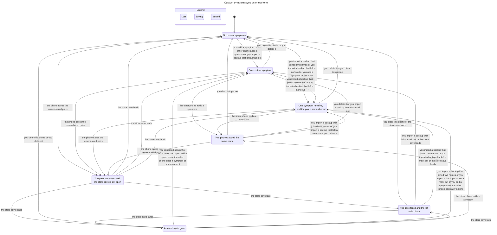

# Custom symptom sync

This picture uses one day, the name fog, and logs a mark only on the first symptom, so the sync fits on one page. The full check uses two days, the names fog and ache, and logs a mark on either symptom. The picture keeps both symptom ids, because the start state names the second one.

## What TLC checked

TLC reached 77328 states on the full check and reported no error. This picture reached 254 states.

LateScoreKept holds. A later mark for a removed copy shows on the symptom that remains.

NeverCombinedHides holds. This phone never combined the pair, so the late mark stays hidden.

WinnerGoneHides holds. The kept symptom is gone, so the mark stays hidden.

UniqueMarkRemains holds. A saved mark stays on its own symptom or on the symptom this phone kept. Deleting it removes it.

EmptyKeeperSafe holds. An empty record id used as the keeper does not remove a mark on another day.

ImportRemembers holds. A backup that combined two names stores the pair.

ScoreOnListedSymptom holds. A score stays on screen while its symptom is still listed.

OrphanStaysOut holds. A mark the file left out stays off the list.

NoDeadlock holds.

The model leaves out chain flattening in `remembering()` and `terminal()`, `prefer`'s tie-break, and case folding where ß and ss differ. It leaves out CloudKit's transport and merge policy, a UserDefaults flush versus the SQLite commit, blank-name rows, and a malformed defaults blob.

`python3 ios/scripts/check-statecharts.py` checks this fence and this picture.

